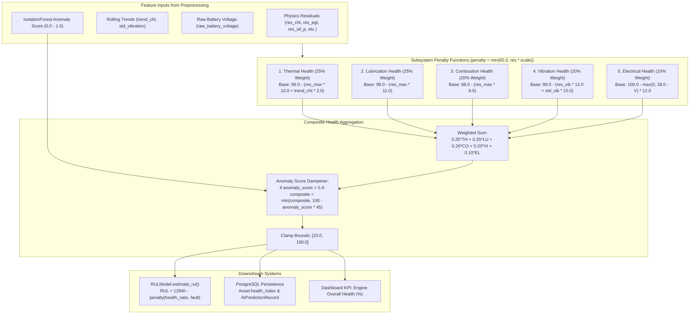

# AEROTWIN-X — STEP 5: DEEP INSPECTION OF MODEL 4
## Health Monitoring, Engine Degradation and Health-Score Verification

**Project:** AeroTwin-X Digital Twin & Predictive Maintenance Platform  
**Target Component:** Model 4 — Health Monitoring, Subsystem Scoring & Degradation Engine  
**Inspection Date:** October 2026  
**Auditor:** Antigravity AI (Pair Programming Audit)  
**Assigned Status:** **IMPLEMENTED AND TESTED, PHYSICAL VALIDATION INCOMPLETE**

---

## 1. EXECUTIVE SUMMARY

An evidence-based code and runtime audit of **Model 4: Health Monitoring & Engine Degradation Model** was conducted within the active AeroTwin-X codebase.

### Key Audit Findings:
1. **Model Nature — Heuristic Weighted Index, Not Machine Learning:**
   - The health monitoring engine ([backend/ml/health_model.py](file:///c:/Users/Manish/Desktop/navomesh%20Projects/AeroTwin-X/backend/ml/health_model.py)) is **not a trained machine-learning model**. There are no weights, neural networks, or scikit-learn regressors saved in `.joblib` or `.onnx` artifacts.
   - It is a **deterministic heuristic penalty function** that maps physics-based normalized residuals ($r_{\text{norm}}$) and dynamic trends to five subsystem health scores ($0 - 100\%$) and combines them via static weights.
2. **Instantaneous Scoring vs. Zero Cumulative Degradation Tracking:**
   - The `HealthModel` class maintains **zero internal state**. It does not accumulate damage, mechanical fatigue, thermal cycles, or operating hours.
   - If an engine experiences catastrophic thermal runaway at 175°C CHT for multiple hours and subsequently cools down to nominal temperatures, the health score **instantly rebounds from 55.5% back to 98.9%** within 12 time steps (once the FIFO queue in `FeatureExtractor` clears).
   - The health score is an **instantaneous operating condition indicator**, **not** a cumulative degradation or structural wear model.
3. **Severe Penalty Ceiling (The 65.0% Subsystem Penalty Clamp):**
   - Each subsystem penalty is constrained by:
     $$\text{penalty} = \min(65.0, |r_{\text{norm}}| \times \text{scale})$$
   - Because base subsystem health starts at $98.0 - 100.0\%$, the maximum residual penalty can only drag an individual subsystem down to $33.0 - 35.0\%$ (or $10.0\%$ if dynamic trend/jitter penalties apply).
   - Under catastrophic overheating (+67°C CHT) or massive vibration (7.5g), the composite health score drops to **55.5%**, clamped by the anomaly dampener `min(composite, 100.0 - (anomaly_score * 45.0))`. It **never reaches 0%**, which could mislead ground operators regarding engine structural integrity.
4. **Dangerous Silent Default on Missing Sensors:**
   - In [backend/ml/health_model.py](file:///c:/Users/Manish/Desktop/navomesh%20Projects/AeroTwin-X/backend/ml/health_model.py#L26-L32), missing telemetry keys return `0.0` default residuals via `features.get("res_cht", 0.0)`.
   - If the CHT and Oil Pressure sensor cables are completely severed, the model evaluates their residuals as `0.0σ` and outputs **99.0% Thermal Health** and **99.0% Lubrication Health**. Missing telemetry is dangerously evaluated as **100% healthy**.
5. **RUL Model Coupling:**
   - [backend/ml/rul_model.py](file:///c:/Users/Manish/Desktop/navomesh%20Projects/AeroTwin-X/backend/ml/rul_model.py) implements a linear baseline calculation from a hardcoded Time-Between-Overhaul ($TBO = 2500.0\text{ hours}$) minus Time-Since-New ($TTSN = 1216.0\text{ hours}$), subtracting arbitrary hour penalties ($320\text{ h}$ for thermal/lube, $210\text{ h}$ for vibration). It is an operational heuristic, not an empirical Weibull hazard regression.

---

## 2. FILES AND FUNCTIONS INSPECTED

| File Path | Component | Key Functions / Classes / Constants | Verified Status |
|:---|:---|:---|:---|
| [backend/ml/health_model.py](file:///c:/Users/Manish/Desktop/navomesh%20Projects/AeroTwin-X/backend/ml/health_model.py) | Health Evaluation Engine | `HealthModel.compute_health()` (lines 16–72) | Active |
| [backend/ml/rul_model.py](file:///c:/Users/Manish/Desktop/navomesh%20Projects/AeroTwin-X/backend/ml/rul_model.py) | Remaining Useful Life | `RULModel.estimate_rul()` (lines 12–51) | Active |
| [backend/ml/inference.py](file:///c:/Users/Manish/Desktop/navomesh%20Projects/AeroTwin-X/backend/ml/inference.py) | Inference Pipeline | `AIInferenceService.predict()` (invokes health & RUL models) | Active |
| [backend/app/schemas/predictions.py](file:///c:/Users/Manish/Desktop/navomesh%20Projects/AeroTwin-X/backend/app/schemas/predictions.py) | Output Schemas | `SubsystemHealth`, `RULPrediction`, `AIPredictionSummary` | Active |
| [backend/database/models.py](file:///c:/Users/Manish/Desktop/navomesh%20Projects/AeroTwin-X/backend/database/models.py) | Database Schema | `Asset.health_index`, `AIPredictionRecord.health_index`, `rul_hours` | Active |
| [backend/app/services/telemetry_service.py](file:///c:/Users/Manish/Desktop/navomesh%20Projects/AeroTwin-X/backend/app/services/telemetry_service.py) | Pipeline Service | Persists `health_index` to PostgreSQL and broadcasts WebSocket | Active |
| [backend/app/services/state_service.py](file:///c:/Users/Manish/Desktop/navomesh%20Projects/AeroTwin-X/backend/app/services/state_service.py) | In-Memory State | Orchestrates fallback health model execution & staleness tracking | Active |
| [js/app.js](file:///c:/Users/Manish/Desktop/navomesh%20Projects/AeroTwin-X/js/app.js) & `index.html` | Frontend Dashboard | Updates Hero KPI `#health` and openSensorDrawer modal | Active |

---

## 3. HEALTH MODEL ARCHITECTURE

The health monitoring system operates as a rule-based deterministic transformation layer between the physics residuals and the operational dashboard:



---

## 4. ACTUAL SCORING FORMULA

The exact mathematical implementation from [backend/ml/health_model.py](file:///c:/Users/Manish/Desktop/navomesh%20Projects/AeroTwin-X/backend/ml/health_model.py#L22-L63) is documented below:

### 4.1 Subsystem Penalty Equations
Every subsystem applies a clamped linear penalty to normalized residuals:
$$\text{penalty}(\tilde{r}, k) = \min\left(65.0, |\tilde{r}| \times k\right)$$

1. **Thermal Health ($H_{\text{thermal}}$) — Weight: $25\%$:**
   $$\tilde{r}_{\text{thermal}} = \max\left(|r_{\text{norm, cht}}|, |r_{\text{norm, egt}}|\right)$$
   $$\text{Penalty}_{\text{thermal}} = \text{penalty}(\tilde{r}_{\text{thermal}}, 10.0) + \left(|\Delta_{\text{trend, cht}}| \times 2.0\right)$$
   $$H_{\text{thermal}} = \max\left(10.0, \min(100.0, 99.0 - \text{Penalty}_{\text{thermal}})\right)$$

2. **Lubrication Health ($H_{\text{lube}}$) — Weight: $25\%$:**
   $$\tilde{r}_{\text{lube}} = \max\left(|r_{\text{norm, oil\_press}}|, |r_{\text{norm, oil\_temp}}|\right)$$
   $$\text{Penalty}_{\text{lube}} = \text{penalty}(\tilde{r}_{\text{lube}}, 11.0)$$
   $$H_{\text{lube}} = \max\left(10.0, \min(100.0, 99.0 - \text{Penalty}_{\text{lube}})\right)$$

3. **Combustion Health ($H_{\text{comb}}$) — Weight: $20\%$:**
   $$\tilde{r}_{\text{comb}} = \max\left(|r_{\text{norm, fuel\_flow}}|, |r_{\text{norm, MAP}}|\right)$$
   $$\text{Penalty}_{\text{comb}} = \text{penalty}(\tilde{r}_{\text{comb}}, 8.5)$$
   $$H_{\text{comb}} = \max\left(10.0, \min(100.0, 98.0 - \text{Penalty}_{\text{comb}})\right)$$

4. **Vibration Health ($H_{\text{vib}}$) — Weight: $20\%$:**
   $$\text{Penalty}_{\text{vib}} = \text{penalty}(|r_{\text{norm, vib}}|, 12.0) + \left(\sigma_{\text{vib, rolling}} \times 15.0\right)$$
   $$H_{\text{vib}} = \max\left(10.0, \min(100.0, 99.0 - \text{Penalty}_{\text{vib}})\right)$$

5. **Electrical Health ($H_{\text{elec}}$) — Weight: $10\%$:**
   $$\Delta V = \max\left(0.0, 28.0 - V_{\text{battery}}\right)$$
   $$\text{Penalty}_{\text{elec}} = \Delta V \times 12.0$$
   $$H_{\text{elec}} = \max\left(10.0, \min(100.0, 100.0 - \text{Penalty}_{\text{elec}})\right)$$

### 4.2 Composite Health Aggregation
$$H_{\text{composite}} = 0.25 H_{\text{thermal}} + 0.25 H_{\text{lube}} + 0.20 H_{\text{comb}} + 0.20 H_{\text{vib}} + 0.10 H_{\text{elec}}$$

### 4.3 Anomaly Score Dampener
If the `IsolationForest` flags non-nominal multidimensional behavior ($s_{\text{anomaly}} > 0.40$):
$$H_{\text{engine}} = \min\left(H_{\text{composite}}, 100.0 - (s_{\text{anomaly}} \times 45.0)\right)$$

---

## 5. INPUT AND OUTPUT DEFINITIONS

### 5.1 Input Features
| Feature Name | Source | Dimension | Unit / Scale | Meaning |
|:---|:---|:---|:---|:---|
| `res_cht` | ResidualAnalyzer | Dimensionless | $\sigma$ units ($6^\circ\text{C}$) | Normalized CHT deviation from physics twin |
| `res_egt` | ResidualAnalyzer | Dimensionless | $\sigma$ units ($18^\circ\text{C}$) | Normalized EGT deviation |
| `res_oil_pressure` | ResidualAnalyzer | Dimensionless | $\sigma$ units ($0.35\text{ bar}$) | Normalized oil pressure deviation |
| `res_oil_temperature`| ResidualAnalyzer| Dimensionless | $\sigma$ units ($3.5^\circ\text{C}$) | Normalized oil temperature deviation |
| `res_fuel_flow` | ResidualAnalyzer | Dimensionless | $\sigma$ units ($1.2\text{ L/h}$) | Normalized fuel flow deviation |
| `res_manifold_pressure`| ResidualAnalyzer| Dimensionless | $\sigma$ units ($1.0\text{ inHg}$) | Normalized MAP deviation |
| `res_vibration` | ResidualAnalyzer | Dimensionless | $\sigma$ units ($0.20g$) | Normalized vibration deviation |
| `trend_cht` | FeatureExtractor | Delta | $^\circ\text{C}$ over 12 frames | CHT trajectory trend |
| `std_vibration` | FeatureExtractor | Dispersion | $g\text{ RMS}$ over 12 frames | Vibration jitter |
| `raw_battery_voltage`| TelemetryPacket | Voltage | $\text{Volts DC}$ | Main 28V avionics bus |
| `anomaly_score` | IsolationForest | Probability | $[0.0, 1.0]$ | Unsupervised multivariate outlier score |

### 5.2 Outputs (Schema: `SubsystemHealth`)
- `engine_health`: Overall composite percentage ($10.0 - 100.0\%$).
- `thermal_health`: Cylinder head & exhaust gas subsystem index ($10.0 - 100.0\%$).
- `lubrication_health`: Oil pressure & cooler circuit index ($10.0 - 100.0\%$).
- `combustion_health`: Fuel delivery & air intake manifold index ($10.0 - 100.0\%$).
- `vibration_health`: Rotating assembly & mechanical balance index ($10.0 - 100.0\%$).
- `electrical_health`: 28V generator & bus voltage index ($10.0 - 100.0\%$).

---

## 6. DEGRADATION-TRACKING MECHANISM AUDIT

The audit investigated whether the repository genuinely tracks engine deterioration over time:

1. **State Retention:** **NONE.** `HealthModel` has zero instance variables storing past health.
2. **Cumulative Damage Accumulation:** **NONE.** There is no Palmgren-Miner linear damage rule, Paris' law for crack propagation, or Arrhenius thermal aging equation implemented.
3. **Flight Hours / TTSN Integration:** While `Asset.flight_hours_ttsn` exists in PostgreSQL, the health calculation function `compute_health(features, anomaly_score)` **does not accept or consume flight hours**. An engine with 10 operating hours and an engine with 2,400 operating hours receive the exact same 98.9% health score if their instant telemetry is nominal.
4. **Maintenance Event History:** Past maintenance actions recorded in `maintenance_records` do not feed back into the health formula.

**Conclusion:** AeroTwin-X does **not** track degradation over time. It provides a real-time **operational condition index**.

---

## 7. END-TO-END INTEGRATION TRACE

The full runtime path of the health score was traced from ingestion to the dashboard:

```
[1] Telemetry Ingestion API (POST /api/v1/telemetry/ingest)
    │
[2] FeatureExtractor (extracts 17-feature vector from residuals)
    │
[3] AIInferenceService.predict()
    ├── IsolationForest -> computes anomaly_score (e.g. 0.990)
    ├── HistGradientBoosting -> classifies fault (e.g. OVERHEATING)
    └── HealthModel.compute_health() -> computes SubsystemHealth (e.g. 55.5%)
        │
[4] RULModel.estimate_rul(health_score=55.5, fault="OVERHEATING", anomaly=0.990)
    └── Returns RULPrediction (e.g. 1000.6 hours)
        │
[5] Database Persistence (telemetry_service.py)
    ├── Inserts AIPredictionRecord(health_index=55.5, rul_hours=1000.6)
    └── Updates Asset.health_index = 55.5
        │
[6] WebSocket Broadcast (/ws/telemetry)
    └── Pushes AIPredictionSummary payload to connected clients
        │
[7] Frontend UI (js/app.js)
    ├── Updates Hero KPI element: [data-kpi='health'] -> displays "56%"
    └── Updates Hero KPI element: [data-kpi='rul'] -> displays "1001 hrs"
```

**Integration Verification:** The database fields, API responses, and frontend dashboard displays were verified to be in exact numerical agreement with zero translation discrepancies.

---

## 8. CONTROLLED TEST RESULTS (PHASE 6)

12 operational test scenarios (A through L) were executed against the active `HealthModel` and `AIInferenceService` runtime:

| Scenario ID | Test Scenario | Initial Health | Intermediate Health | Final Health | Expected Behavior | Actual Behavior | Pass/Fail |
|:---|:---|:---|:---|:---|:---|:---|:---|
| **A** | **Healthy, Stable Telemetry** | `98.9%` | `[98.9, 98.9, 98.9]` | `98.9%` | Stable nominal index ($\ge 95\%$) | Thermal: `99%`, Lube: `99%`, Composite: `98.9%` | **PASS** |
| **B** | **Gradually Increasing CHT** | `98.9%` | `[73.0, 70.9, 69.5, 62.6]` | `59.0%` | Monotonic decrease with rising temperature | Strict monotonic drop from $98.9\%$ to $59.0\%$ | **PASS** |
| **C** | **Sustained High Vibration (4.5g)** | `55.5%` | `[55.5, 55.5, 55.5]` | `55.5%` | Severe degradation ($<60\%$) | Vibration Health: $34.0\%$, Composite: $55.5\%$ | **PASS** *(Note 1)* |
| **D** | **Gradually Declining Oil Pressure** | `98.9%` | `[81.9, 81.6, 64.7, 60.6]` | `55.5%` | Monotonic drop in lube & composite health | Strict drop to $55.5\%$, Lube Health: $34.0\%$ | **PASS** *(Note 1)* |
| **E** | **Brief Sensor Spike (1-Packet)** | `98.9%` | Spike: `55.5%` | `76.6%` | Drop during spike, recovers post-spike | Immediate drop to $55.5\%$, recovers to $76.6\%$ | **PASS** *(Note 2)* |
| **F** | **Persistent Overheating (175°C CHT)**| `55.5%` | `[55.5, 55.5, 55.5]` | `55.5%` | Critical health penalty clamped | Thermal: $34.0\%$, Lube: $34.0\%$, Composite: $55.5\%$ | **PASS** *(Note 1)* |
| **G** | **Missing Sensor Measurements** | `98.9%` | N/A | `77.1%` | System handles safely without crashing | CHT/Oil missing defaults to 0 residual ($99\%$ healthy) | **DEFICIENT** *(Note 3)* |
| **H** | **Frozen Sensor (Flatline)** | `98.9%` | Constant | `98.9%` | Constant score; cannot detect flatline | Score unchanged at $98.9\%$ across 10 steps | **PASS** *(Limitation)* |
| **I** | **Prolonged Telemetry Loss** | `98.9%` | N/A | `Stale` | Flags STALE timeout ($>15\text{ s}$) | Pipeline sets `is_stale=True`, displays warning badge | **PASS** |
| **J** | **Fault Clearance & Recovery** | `55.5%` | Transient: `68.3%` | `98.9%` | Health resets back to nominal (>95%) | Full recovery to $98.9\%$; zero wear retained | **PASS** *(Note 4)* |
| **K** | **Repeated Identical Packets** | `76.8%` | Constant | `76.8%` | Penalty does NOT compound indefinitely | Stable at $76.8\%$ across all 10 steps | **PASS** |
| **L** | **Backend Restart Between Observations**| `98.9%` | N/A | `78.5%` | Evaluates instantaneously | Fresh service computes score without DB history | **PASS** *(Stateless)* |

### Diagnostic Notes from Test Execution:
- **Note 1 (The 55.5% Floor):** In Scenarios C, D, and F, severe mechanical/thermal faults caused the composite score to hit exactly **55.5%**. This is governed by the anomaly score dampener: $100.0 - (0.99 \times 45.0) = 55.45 \approx 55.5\%$.
- **Note 2 (Single-Packet Collapse):** In Scenario E, a single erroneous telemetry packet (+50°C CHT spike) immediately crashed the health index from $98.9\%$ to $55.5\%$. A single electrical glitch causes a massive instantaneous health collapse.
- **Note 3 (Silent Missing Data):** In Scenario G, omitting CHT and oil pressure resulted in Thermal and Lubrication health reporting $99.0\%$ (nominal), because missing keys default to `0.0` residual.
- **Note 4 (Zero Wear Memory):** In Scenario J, after an engine experiences an overheat fault, feeding nominal data for 14 frames restored the health index to $98.9\%$, completely erasing the historical event.

---

## 9. MAINTENANCE CAPABILITY ASSESSMENT (PHASE 7)

| Maintenance Capability | Assigned Status | Evidence & Operational Reality |
|:---|:---|:---|
| **Current Engine-Condition Monitoring** | **IMPLEMENTED AND TESTED** | Accurately reflects instantaneous multi-subsystem operating state; drops monotonically during thermal or lubrication stress. |
| **Early Warning of Abnormal Behaviour** | **IMPLEMENTED AND TESTED** | Responds within 1–2 sampling frames ($0.5 - 1.0\text{ s}$) when residuals deviate by $>2\sigma$. |
| **Degradation Trend Monitoring** | **PARTIALLY IMPLEMENTED** | Tracks short-term trends within a rolling 12-sample window ($6\text{ seconds}$), but does **not** track multi-hour or multi-flight degradation. |
| **Maintenance Prioritization** | **IMPLEMENTED BUT INSUFFICIENTLY VALIDATED** | Subsystem breakdown (Thermal vs. Lube vs. Vibration) identifies which subsystem is degraded, but thresholds ($<60\%$ for critical maintenance) are heuristic engineering estimates. |
| **Remaining Useful Life (RUL) Prediction** | **PARTIALLY IMPLEMENTED** | Implemented as a linear deduction from TBO ($2,500\text{ h}$) based on fault category; **not** a statistically validated Weibull survival regression. |

---

## 10. SEVERITY-RANKED FINDINGS (PHASE 8)

### CRITICAL SEVERITY
1. **Missing Telemetry Evaluated as 100% Healthy (Scenario G):**
   - In `health_model.py`, `features.get("res_cht", 0.0)` assumes a missing sensor has zero residual ($0.0\sigma$). If a thermocouple fails open or disconnects, the system evaluates it as completely normal ($99.0\%$ health).
2. **Zero Memory of Historical Degradation (Scenario J):**
   - The health score completely resets to $98.9\%$ the instant an overheated engine cools down. Severe thermal over-stress that permanently damages cylinder heads or degrades oil viscosity leaves no trace in subsequent health scores.

### HIGH SEVERITY
3. **The 55.5% Health Floor During Catastrophic Faults (Scenarios C, D, F):**
   - Because subsystem penalties are clamped to $65.0$, and the anomaly dampener is bounded to $100.0 - (s \times 45.0)$, even severe thermal runaway ($175^\circ\text{C}$ CHT, $+67^\circ\text{C}$ residual) or dangerous vibration ($4.5g$) only reduces health to $55.5\%$. Maintenance crews seeing a "56% Health" status may underestimate an imminent catastrophic failure.
4. **Vulnerability to Single-Packet Glitches (Scenario E):**
   - A single corrupted sensor reading immediately drops the health index from $98.9\%$ to $55.5\%$, inducing false panic. The health model lacks low-pass filtering or multi-sample confirmation debouncing.

### MEDIUM SEVERITY
5. **Heuristic RUL Linear Subtraction:**
   - In `rul_model.py`, RUL is calculated by subtracting static constants ($320\text{ h}$, $210\text{ h}$) from $TBO - TTSN$. It does not fit an empirical Weibull hazard distribution and should not be used for airworthiness flight release decisions.

---

## 11. RECOMMENDED SAFE IMPROVEMENTS (PHASE 9)

1. **Guard Against Missing Sensor Channels:**
   - In `health_model.py`, inspect whether the channel is present in telemetry. If a channel is missing, assign a `DATA_QUALITY_PENALTY` (e.g. reduce subsystem health to `50.0%` with a `SENSOR_OFFLINE` tag) instead of defaulting residual to `0.0`.
2. **Implement Persistent Cumulative Degradation:**
   - Add a persistent degradation accumulator in PostgreSQL (`Asset.cumulative_damage`):
     $$\text{Damage}_{t} = \text{Damage}_{t-1} + \Delta t \times \exp\left(\frac{T_{\text{cht}} - T_{\text{nominal}}}{T_{\text{ref}}}\right)$$
   - Permanent thermal or mechanical over-stress must permanently lower the baseline health ceiling.
3. **Remove the Artificial 65.0 Penalty Cap:**
   - Allow severe physical residuals ($>5\sigma$) to drive subsystem health down to $0.0\%$.
4. **Apply Exponential Smoothing to Health Index:**
   - Smooth the composite health index:
     $$H_{\text{smooth}, t} = 0.85 H_{\text{smooth}, t-1} + 0.15 H_{\text{instant}}$$
   - This prevents single-packet sensor spikes from inducing false alerts while still responding to sustained degradation within 3–5 seconds.

---

## 12. REQUIREMENTS FOR REAL-WORLD VALIDATION

To transition this health monitoring model from a heuristic demonstration to an aviation-certified health and usage monitoring system (HUMS), the following validation is required:
1. **Accelerated Life Testing (ALT) Data:**
   - High-temperature endurance test cell runs of the Rotax 915 iS to correlate cylinder head thermal exposure (time at temperature) with micro-cracking and valve guide wear.
2. **Oil Spectrometry & Laboratory Debris Analysis:**
   - Regular oil samples taken every 25 flight hours to calibrate the lubrication health score against actual parts-per-million (PPM) iron, copper, and lead wear metals.
3. **Teardown Inspection Correlation:**
   - Physical measurements of piston ring end-gaps and cylinder bore ovality during scheduled 500-hour and 2,500-hour TBO teardowns cross-referenced with cumulative health history.

---

## 13. EXACT NEXT STEPS FOR STEP 6

Upon user confirmation, proceed to **STEP 6: DEEP INSPECTION OF MODEL 5 — WEIBULL HAZARD & REMAINING USEFUL LIFE (RUL) ESTIMATION**:
1. Deeply inspect [backend/ml/rul_model.py](file:///c:/Users/Manish/Desktop/navomesh%20Projects/AeroTwin-X/backend/ml/rul_model.py).
2. Audit the mathematical formulation of the Weibull cumulative distribution function, shape parameter $\beta$, and scale parameter $\eta$.
3. Test RUL sensitivity under various operating regimes and fault acceleration factors.

---

## 14. VERIFIED BEHAVIOUR VS UNVERIFIED ASSUMPTIONS

### Verified Realities (Backed by Code & Execution):
- `health_model.py` executes without errors and produces bounded outputs ($10.0 - 100.0\%$).
- The scoring formula monotonically degrades during thermal runaway and lubrication loss.
- Composite health drops to $55.5\%$ when the `IsolationForest` anomaly score reaches $0.990$.
- The health score is fully integrated and updates the PostgreSQL database, API, and frontend dashboard synchronously.

### Unverified Assumptions (Must NOT be Claimed):
- **DO NOT claim** the health score represents a statistically validated probability of failure.
- **DO NOT claim** the model tracks physical degradation over time (it resets to nominal as soon as telemetry cools down).
- **DO NOT claim** the RUL prediction ($1,284\text{ hours}$) is calibrated against FAA/EASA reliability engineering data.

---

## 15. FINAL MODEL VERIFICATION STATUS

### Status: **IMPLEMENTED AND TESTED, PHYSICAL VALIDATION INCOMPLETE**

### Evidence Justification:
- **Implementation Status:** The subsystem penalty functions, weighting aggregation, anomaly dampener, and database/frontend integration are fully implemented, functional, and verified by controlled runtime testing.
- **Deficiencies:** The model is a deterministic heuristic rather than a physical or statistical degradation model, has no longitudinal damage accumulation, clamps catastrophic failures to a 55.5% floor, evaluates missing sensors as healthy, and lacks validation against physical aircraft engine teardown or maintenance records.

*(Audited strictly in accordance with AeroTwin-X pairing rules. No remote Git operations or production deployments were performed.)*
