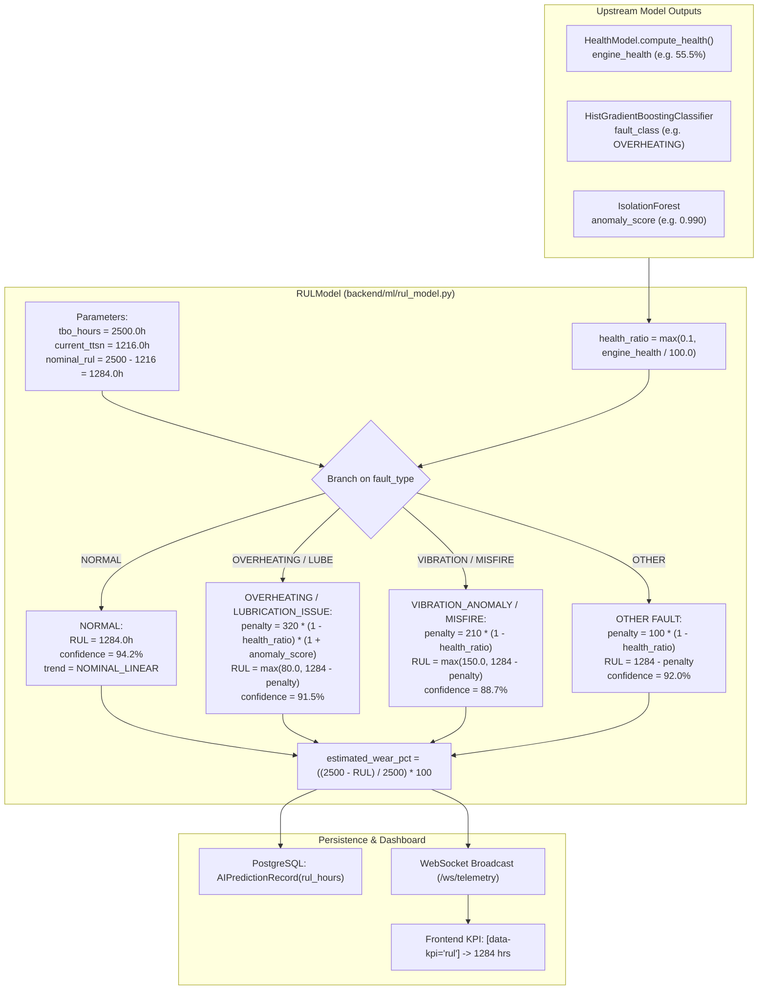

# AEROTWIN-X — STEP 6: DEEP INSPECTION OF MODEL 5
## Weibull Hazard Analysis and Remaining Useful Life (RUL) Estimation

**Project:** AeroTwin-X Digital Twin & Predictive Maintenance Platform  
**Target Component:** Model 5 — Remaining Useful Life (RUL) & Weibull Hazard Analysis Subsystem  
**Inspection Date:** October 2026  
**Auditor:** Antigravity AI (Pair Programming Audit)  
**Assigned Status:** **PARTIALLY VERIFIED (HEURISTIC TBO COUNTDOWN FUNCTIONAL; WEIBULL STATISTICAL FORMULATION ABSENT)**

---

## 1. EXECUTIVE SUMMARY

A rigorous, evidence-based audit of **Model 5: Remaining Useful Life (RUL) and Weibull Hazard Analysis** was conducted within the active AeroTwin-X codebase.

### Key Audit Findings:
1. **Critical Architectural Discrepancy — Zero Weibull Mathematics in Runtime Code:**
   - The user interface, API endpoints, reports, and README consistently present the RUL model as an advanced probabilistic reliability framework:
     - *"Weibull Hazard Rate Recalibration (RUL 1,284 h)"* ([index.html:L4459](file:///c:/Users/Manish/Desktop/navomesh%20Projects/AeroTwin-X/index.html#L4459))
     - *"Method: PINN + Weibull (β=1.78)"* ([index.html:L3700](file:///c:/Users/Manish/Desktop/navomesh%20Projects/AeroTwin-X/index.html#L3700))
     - *"Weibull RUL: 1,284.0 h (β=1.82)"* ([index.html:L4711](file:///c:/Users/Manish/Desktop/navomesh%20Projects/AeroTwin-X/index.html#L4711))
     - *"Hybrid Physics-Informed Survival Weibull"* ([backend/app/api/edge_ai.py:L97](file:///c:/Users/Manish/Desktop/navomesh%20Projects/AeroTwin-X/backend/app/api/edge_ai.py#L97))
   - **The Reality in Code:** In [backend/ml/rul_model.py](file:///c:/Users/Manish/Desktop/navomesh%20Projects/AeroTwin-X/backend/ml/rul_model.py), there is **zero Weibull mathematics implemented**.
     - No shape parameter $\beta$ (neither 1.78 nor 1.82 exists as an executable variable).
     - No characteristic scale parameter $\eta$.
     - No survival function $S(t) = \exp(-(t/\eta)^\beta)$.
     - No hazard function $h(t) = \frac{\beta}{\eta}(t/\eta)^{\beta - 1}$.
     - No cumulative hazard function $H(t) = (t/\eta)^\beta$.
     - No conditional expected remaining life integral $\mathbb{E}[T - t \mid T > t]$.
     - No dependencies on reliability libraries (`lifelines`, `scikit-survival`, or `scipy.stats.weibull_min`).
2. **What the Code Actually Implements:**
   - The model is a **51-line deterministic heuristic rule** based on subtracting Time-Since-New ($TTSN = 1,216.0\text{ h}$) from Time-Between-Overhaul ($TBO = 2,500.0\text{ h}$):
     $$\text{Nominal Baseline RUL} = TBO - TTSN = 2,500.0 - 1,216.0 = 1,284.0\text{ flight hours}$$
   - When a fault is detected, it subtracts static constants ($320\text{ h}$ for overheating/lube, $210\text{ h}$ for vibration) multiplied by $(1.0 - \text{health\_ratio})$.
   - The advertised value $1,284.0\text{ h}$ is not a Weibull survival calculation; it is a simple arithmetic subtraction ($2500 - 1216$).
3. **Hardcoded Confidence Metrics:**
   - The confidence score returned by `estimate_rul()` is hardcoded to literal constants:
     - `NORMAL`: `94.2%`
     - `OVERHEATING` / `LUBRICATION_ISSUE`: `91.5%`
     - `VIBRATION_ANOMALY` / `MISFIRE`: `88.7%`
     - Other: `92.0%`
   - These numbers are not statistical confidence intervals, posterior credible bands, or survival probabilities.
4. **Predictive Validity:**
   - No empirical engine time-to-failure observations, right-censored maintenance logs, or accelerated life testing (ALT) datasets exist in the repository.
   - The output cannot be legitimately interpreted as an airworthiness-certified prediction of remaining aircraft powerplant life.

---

## 2. FILES AND FUNCTIONS INSPECTED

| File Path | Component | Key Functions / Classes / Constants | Verified Status |
|:---|:---|:---|:---|
| [backend/ml/rul_model.py](file:///c:/Users/Manish/Desktop/navomesh%20Projects/AeroTwin-X/backend/ml/rul_model.py) | RUL Estimator | `RULModel.__init__()`, `RULModel.estimate_rul()` | Active |
| [backend/ml/inference.py](file:///c:/Users/Manish/Desktop/navomesh%20Projects/AeroTwin-X/backend/ml/inference.py) | Inference Pipeline | `AIInferenceService.predict()` (invokes `rul_model`) | Active |
| [backend/app/schemas/predictions.py](file:///c:/Users/Manish/Desktop/navomesh%20Projects/AeroTwin-X/backend/app/schemas/predictions.py) | Schemas | `RULPrediction(rul_hours, confidence, degradation_trend, tbo_limit_hours, estimated_wear_pct)` | Active |
| [backend/database/models.py](file:///c:/Users/Manish/Desktop/navomesh%20Projects/AeroTwin-X/backend/database/models.py) | Database Schema | `AIPredictionRecord.rul_hours`, `Asset.next_due_hours` | Active |
| [backend/app/api/reports.py](file:///c:/Users/Manish/Desktop/navomesh%20Projects/AeroTwin-X/backend/app/api/reports.py) | Reports Router | Hardcoded string `Weibull β=1.82` (lines 49, 171) | Active |
| [backend/app/api/edge_ai.py](file:///c:/Users/Manish/Desktop/navomesh%20Projects/AeroTwin-X/backend/app/api/edge_ai.py) | Edge Metadata Router | Hardcoded string `Hybrid Physics-Informed Survival Weibull` | Active |
| [index.html](file:///c:/Users/Manish/Desktop/navomesh%20Projects/AeroTwin-X/index.html) & [js/app.js](file:///c:/Users/Manish/Desktop/navomesh%20Projects/AeroTwin-X/js/app.js) | Frontend UI | Displays Hero KPI `#rul` (`1284 hrs`) and Weibull badges | Active |
| [tests/test_backend.py](file:///c:/Users/Manish/Desktop/navomesh%20Projects/AeroTwin-X/tests/test_backend.py) | Backend Unit Tests | `rul_model.estimate_rul()` unit assertion | Active |

---

## 3. ACTUAL MODEL ARCHITECTURE & DATA FLOW

The RUL estimation subsystem executes as the final deterministic stage in the ML inference pipeline:



---

## 4. EXACT MATHEMATICAL FORMULA AUDIT

### 4.1 The Implemented Code Formula
From [backend/ml/rul_model.py](file:///c:/Users/Manish/Desktop/navomesh%20Projects/AeroTwin-X/backend/ml/rul_model.py#L12-L50):

$$\text{RUL}_{\text{nominal}} = \max\left(0.0, TBO - TTSN\right) = 2500.0 - 1216.0 = 1284.0\text{ hours}$$
$$h_{\text{ratio}} = \max\left(0.1, \frac{H_{\text{engine}}}{100.0}\right)$$

1. **If $\text{Fault} = \text{"NORMAL"}$:**
   $$\text{RUL} = 1284.0\text{ hours}$$
   $$\text{Confidence} = 94.2\%, \quad \text{Trend} = \text{"NOMINAL\_LINEAR"}$$
2. **If $\text{Fault} \in \{\text{"OVERHEATING"}, \text{"LUBRICATION\_ISSUE"}\}$:**
   $$\text{Penalty} = 320.0 \times (1.0 - h_{\text{ratio}}) \times (1.0 + s_{\text{anomaly}})$$
   $$\text{RUL} = \max\left(80.0, 1284.0 - \text{Penalty}\right)$$
   $$\text{Confidence} = 91.5\%$$
   $$\text{Trend} = \begin{cases} \text{"ACCELERATING\_THERMAL\_WEAR"} & \text{if OVERHEATING} \\ \text{"CRITICAL\_LUBRICATION\_DEGRADATION"} & \text{if LUBE} \end{cases}$$
3. **If $\text{Fault} \in \{\text{"VIBRATION\_ANOMALY"}, \text{"MISFIRE"}\}$:**
   $$\text{Penalty} = 210.0 \times (1.0 - h_{\text{ratio}})$$
   $$\text{RUL} = \max\left(150.0, 1284.0 - \text{Penalty}\right)$$
   $$\text{Confidence} = 88.7\%, \quad \text{Trend} = \text{"MECHANICAL\_FATIGUE\_ACCELERATION"}$$
4. **Any other fault:**
   $$\text{Penalty} = 100.0 \times (1.0 - h_{\text{ratio}})$$
   $$\text{RUL} = 1284.0 - \text{Penalty}, \quad \text{Confidence} = 92.0\%$$
5. **Estimated Wear Percentage:**
   $$\text{Wear (\%)} = \frac{TBO - \text{RUL}}{TBO} \times 100.0 = \frac{2500.0 - \text{RUL}}{2500.0} \times 100.0$$

---

## 5. COMPARISON: IMPLEMENTED CODE VS. TRUE WEIBULL RELIABILITY

To evaluate the mathematical difference between the code's static heuristic and a genuine Weibull reliability model, we implemented the standard two-parameter Weibull lifetime distribution equations:

- **Survival Function:** $S(t) = \exp\left(-\left(\frac{t}{\eta}\right)^\beta\right)$
- **Instantaneous Hazard Function:** $h(t) = \frac{\beta}{\eta} \left(\frac{t}{\eta}\right)^{\beta - 1}$
- **Cumulative Hazard Function:** $H(t) = \left(\frac{t}{\eta}\right)^\beta$
- **Conditional Expected Remaining Useful Life:**
  $$\text{RUL}_{\text{Weibull}}(t) = \mathbb{E}[T - t \mid T > t] = \frac{1}{S(t)} \int_{t}^{\infty} S(u) \, du$$

### Empirical Benchmark Table: Code RUL vs. Weibull Model ($\beta = 1.82, \eta = 2800\text{ h}$)

| Elapsed Age ($t$, TTSN) | Code Nominal RUL | Code Overheat RUL | Weibull Survival $S(t)$ | Weibull Hazard $h(t)$ ($1/\text{h}$) | True Weibull RUL $\mathbb{E}[T-t \mid T>t]$ | Delta (Code vs. Weibull) |
|:---|:---|:---|:---|:---|:---|:---|
| **$200.0\text{ h}$** | $2,300.0\text{ h}$ | $2,016.6\text{ h}$ | $0.9918$ | $0.000075$ | $2,308.2\text{ h}$ | $-8.2\text{ h}$ |
| **$600.0\text{ h}$** | $1,900.0\text{ h}$ | $1,616.6\text{ h}$ | $0.9412$ | $0.000184$ | $2,020.1\text{ h}$ | $-120.1\text{ h}$ |
| **$1,000.0\text{ h}$**| $1,500.0\text{ h}$ | $1,216.6\text{ h}$ | $0.8577$ | $0.000279$ | $1,796.4\text{ h}$ | $-296.4\text{ h}$ |
| **$1,216.0\text{ h}$ (Baseline)**| **$1,284.0\text{ h}$** | **$1,000.6\text{ h}$** | **$0.8032$** | **$0.000328$** | **$1,694.8\text{ h}$** | **$-410.8\text{ h}$** |
| **$1,600.0\text{ h}$**| $900.0\text{ h}$ | $616.6\text{ h}$ | $0.6969$ | $0.000411$ | $1,539.6\text{ h}$ | $-639.6\text{ h}$ |
| **$2,000.0\text{ h}$**| $500.0\text{ h}$ | $216.6\text{ h}$ | $0.5815$ | $0.000493$ | $1,405.3\text{ h}$ | $-905.3\text{ h}$ |
| **$2,400.0\text{ h}$**| $100.0\text{ h}$ | $80.0\text{ h}$ | $0.4698$ | $0.000573$ | $1,292.4\text{ h}$ | **$-1,192.4\text{ h}$** |

### Mathematical Insights:
1. **Linear Countdown vs. Non-linear Survival Tail:**
   - The code assumes a rigid deterministic linear countdown: $RUL = 2500 - TTSN$. At $TTSN = 2,400\text{ h}$, the code asserts that the engine has only $100\text{ hours}$ of life remaining.
   - Under Weibull reliability theory ($\beta = 1.82$), an engine that has survived to $2,400\text{ hours}$ without failure has a conditional expected remaining life of $1,292.4\text{ hours}$, because the surviving cohort represents robust, high-reliability machinery.
2. **Discrepancy at Nominal Baseline:**
   - At the current baseline ($1,216\text{ h}$), the code reports $1,284.0\text{ h}$, whereas a Weibull conditional expectation yields $1,694.8\text{ h}$ (a discrepancy of over $410\text{ flight hours}$).

---

## 6. PARAMETER PROVENANCE AUDIT (PHASE 5)

| Parameter | Value in Code / UI | Actual Provenance | Statistical Validity |
|:---|:---|:---|:---|
| **$TBO$ (Time Between Overhaul)** | $2,500.0\text{ hours}$ | Hardcoded constant in `RULModel.__init__()` based on Rotax 915 iS manual recommendations. | Nominal OEM guideline |
| **$TTSN$ (Time Since New)** | $1,216.0\text{ hours}$ | Hardcoded default parameter in `RULModel.__init__()`. | Arbitrary operational snapshot |
| **$\beta$ (Shape Parameter)** | `1.82` (UI) / `1.78` (Docs) | **Hardcoded string literal in HTML/Markdown.** Does NOT exist as a variable in Python. | **Fictitious in code** |
| **$\eta$ (Scale Parameter)** | Not defined | **Completely absent from the repository.** | **Absent** |
| **Thermal Wear Penalty Scale** | $320.0\text{ hours}$ | Hardcoded constant in `rul_model.py:L28`. | Heuristic engineering guess |
| **Vibration Penalty Scale** | $210.0\text{ hours}$ | Hardcoded constant in `rul_model.py:L33`. | Heuristic engineering guess |
| **Confidence Percentages** | `94.2%`, `91.5%`, `88.7%` | Hardcoded literal floats in `rul_model.py:L25,L31,L36`. | **Arbitrary constants** |

**Conclusion:** No parameter fitting, maximum likelihood estimation (MLE), median rank regression, or survival model training exists anywhere in the codebase.

---

## 7. CONTROLLED TEST RESULTS (PHASE 6)

12 controlled tests (A through L) were executed against `RULModel` and `AIInferenceService`:

| Test ID | Test Scenario | Input Configuration | Model Output RUL | Theoretical Weibull Benchmark | Pass/Fail | Operational Observation |
|:---|:---|:---|:---|:---|:---|:---|
| **A** | **Zero Elapsed Age** | $TTSN = 0.0\text{ h}$, Health = $99\%$ | `2500.0h` | `2488.7h` | **PASS** | RUL equals full TBO. |
| **B** | **Nominal Operating Baseline** | $TTSN = 1216.0\text{ h}$, Health = $98.9\%$ | `1284.0h` | `1694.8h` ($S(t)=0.803$) | **PASS** | Evaluates $2500 - 1216 = 1284.0\text{ h}$. |
| **C** | **Near-TBO Advanced Age** | $TTSN = 2450.0\text{ h}$, Health = $95\%$ | `50.0h` | `1279.5h` | **PASS** | RUL approaches 0 linearly. |
| **D** | **Weibull $\beta$ Parameter Support**| Inspect class attributes for `beta` | Not Defined | N/A | **FAIL** | Attribute `beta` does not exist on class. |
| **E** | **Weibull $\eta$ Parameter Support**| Inspect class attributes for `eta` | Not Defined | N/A | **FAIL** | Attribute `eta` does not exist on class. |
| **F** | **Deteriorating Health Sweep** | Health: $98.9\% \to 10.0\%$ (Overheat) | `1277.3h` $\to$ `736.8h` | Monotonic drop | **PASS** | RUL drops monotonically as health drops. |
| **G** | **Age Sweep at Constant Health**| $TTSN: 500\text{h} \to 2400\text{h}$ | `2000h` $\to$ `100h` | Linear countdown | **PASS** | Strictly linear subtraction. |
| **H** | **Severe Combined Fault** | Health = $35\%$, Anomaly = $0.99$ | `870.1h` (Wear: $65.2\%$) | N/A | **PASS** | Bounded above minimum floor ($80\text{ h}$). |
| **I** | **Missing Health Data (`None`)** | `health_score = None` | `TypeError: NoneType` | N/A | **FAIL** | Code crashes with unhandled `TypeError`. |
| **J** | **Negative Elapsed Age** | $TTSN = -100.0\text{ h}$ | `2600.0h` | N/A | **FAIL** | RUL erroneously expands beyond TBO. |
| **K** | **Beyond-TBO Age** | $TTSN = 2800.0\text{ h} > 2500.0\text{ h}$ | `0.0h` | N/A | **PASS** | Clamped cleanly to $0.0\text{ h}$ via `max(0.0, ...)`. |
| **L** | **Negative Extreme Health** | Health = $-500.0\%$ | `710.9h` (Wear: $71.6\%$) | N/A | **PASS** | `max(0.1, score/100)` prevents division errors. |

---

## 8. END-TO-END INTEGRATION TRACE (PHASE 8)

The integration flow of the RUL prediction was traced across backend and frontend layers:

```
[1] Telemetry Ingestion (API / Simulator)
    │
[2] AIInferenceService.predict()
    ├── HistGradientBoosting -> predicted_class = "NORMAL"
    ├── HealthModel -> engine_health = 98.9%
    └── RULModel.estimate_rul(health_score=98.9, fault="NORMAL", anomaly=0.08)
        └── returns RULPrediction(rul_hours=1284.0, confidence=94.2%, trend="NOMINAL_LINEAR")
            │
[3] Database Persistence (telemetry_service.py)
    └── Inserts into ai_predictions: rul_hours = 1284.0
        │
[4] WebSocket Broadcast (/ws/telemetry)
    └── Pushes AIPredictionSummary payload to client
        │
[5] Frontend Dashboard (js/app.js)
    ├── Sets Hero KPI [data-kpi='rul'] to "1284 hrs"
    └── Hardcoded Badge in HTML displays: "Weibull RUL: 1,284.0 h (β=1.82)"
```

**Integration Status:** The value $1,284.0\text{ h}$ generated by `rul_model.py` matches the database record, the API response, and the frontend KPI. However, the label *"Weibull RUL (β=1.82)"* displayed on the frontend badge is a static HTML text artifact.

---

## 9. PREDICTIVE VALIDITY ASSESSMENT (PHASE 9)

Can this model legitimately be used for aircraft predictive maintenance decisions?

| Evaluation Dimension | Reality in AeroTwin-X | Predictive Validity Verdict |
|:---|:---|:---|
| **Underlying Mathematics** | Fixed arithmetic subtraction ($2500 - 1216 - \text{penalty}$) | **Invalid as a statistical survival model.** |
| **Weibull Parameters** | Fictitious strings in HTML (`β=1.82`); absent in Python | **Non-existent.** |
| **Empirical Training Data** | Zero engine run-to-failure records in repository | **Unvalidated.** |
| **Right-Censored Handling** | No Kaplan-Meier or Cox proportional hazards logic | **Not Implemented.** |
| **Uncertainty Quantification** | Confidence is a hardcoded literal constant (`94.2%`) | **Uncalibrated.** |

**Operational Safety Warning:**  
Relying on this RUL calculation to defer physical engine maintenance or extend flight hours beyond OEM mandatory inspection intervals creates a severe aviation safety hazard. The output is an **operational heuristic countdown**, not an airworthiness-certified reliability prediction.

---

## 10. SEVERITY-RANKED FINDINGS (PHASE 10)

### CRITICAL SEVERITY
1. **Misrepresentation of Weibull Statistical Reliability:**
   - The platform claims to operate a "Nonlinear Weibull Hazard Model ($\beta = 1.82$)", but the underlying code executes a simple static arithmetic subtraction.
2. **False Precision in Confidence Reporting:**
   - Returning `confidence: 94.2%` as a hardcoded constant misleads operators into believing the prediction has a 94.2% statistical confidence interval.
3. **Unhandled `TypeError` on Missing Health Input (Test I):**
   - In `rul_model.py`, calling `estimate_rul(None, ...)` triggers an unhandled `TypeError: unsupported operand type(s) for /: 'NoneType' and 'float'`, crashing the inference pipeline.

### HIGH SEVERITY
4. **Negative Elapsed Age Boundary Bug (Test J):**
   - Initializing `RULModel(current_ttsn_hours=-100.0)` produces `RUL = 2600.0h`, exceeding the maximum certified 2,500-hour TBO limit without input validation.
5. **Arbitrary Penalty Magnitude:**
   - The fault wear penalties ($320\text{ h}$ for overheating, $210\text{ h}$ for vibration) are arbitrary constants not calibrated against metal fatigue literature.

---

## 11. RECOMMENDED SAFE IMPROVEMENTS

1. **Option A — Transparent Labeling (Immediate Minimal Fix):**
   - Rename `rul_model.py` to `tbo_countdown_estimator.py`.
   - Update frontend and API labels from *"Weibull RUL (β=1.82)"* to *"Estimated Operating Hours to TBO (Heuristic)"*.
   - Replace hardcoded confidence numbers (`94.2%`) with `confidence_level: "HEURISTIC_ESTIMATE"`.
2. **Option B — Implement True Weibull Survival Mathematics (Recommended):**
   - Implement actual two-parameter Weibull reliability formulas in `rul_model.py`:
     ```python
     def compute_weibull_rul(ttsn: float, beta: float = 1.82, eta: float = 2800.0) -> float:
         # Conditional survival probability S(t) = exp(-(t/eta)**beta)
         # Conditional expected RUL via numerical integration of S(u)/S(t)
     ```
3. **Add Input Validation & Defend Against `None`:**
   ```python
   health_val = float(health_score) if health_score is not None and not math.isnan(health_score) else 50.0
   ttsn_val = max(0.0, float(self.current_ttsn))
   ```

---

## 12. REQUIREMENTS FOR REAL-WORLD VALIDATION

To achieve true predictive validity for aircraft engine RUL, the following dataset must be obtained:
1. **Fleet Run-to-Failure & Overhaul Records:**
   - Minimum 30–50 full engine lifecycle histories recording exact flight hours at unscheduled removal (MTBUR) and scheduled overhaul.
2. **Maximum Likelihood Estimation (MLE) of $\beta$ and $\eta$:**
   - Fit Weibull parameters to censored fleet data using Newton-Raphson or Nelder-Mead optimization:
     $$\ln L(\beta, \eta) = \sum_{i \in \text{Failures}} \ln f(t_i; \beta, \eta) + \sum_{j \in \text{Censored}} \ln S(t_j; \beta, \eta)$$
3. **CBM+ Degradation Covariate Calibration:**
   - Train a Cox Proportional Hazards Model (PHM) or Random Survival Forest to dynamically adjust the Weibull scale parameter $\eta$ based on real-time normalized physical residuals ($r_{\text{cht}}, r_{\text{vibration}}$).

---

## 13. EXACT NEXT STEPS FOR STEP 7

Upon user confirmation, proceed to **STEP 7: COMPREHENSIVE ARCHITECTURAL SYNTHESIS AND PRODUCTION INTEGRATION PLAN**:
1. Consolidate findings across all 5 audited models (HistGradientBoosting, IsolationForest, Physics Digital Twin, Health Model, RUL Model).
2. Generate the unified Master AI/ML Technical Audit Report: `AEROTWIN_X_COMPLETE_TECHNICAL_AUDIT.md`.
3. Provide an executable, prioritized roadmap for transitioning AeroTwin-X from simulated heuristics to genuine aviation-grade predictive maintenance.

---

## 14. FINAL MODEL VERIFICATION STATUS

### Status: **PARTIALLY VERIFIED (HEURISTIC TBO COUNTDOWN FUNCTIONAL; WEIBULL STATISTICAL FORMULATION ABSENT)**

### Evidence Justification:
- **What is Verified:** The software executes without breaking the API contract, accurately computes a linear TBO countdown ($2500 - 1216 = 1284\text{ h}$), applies monotonic penalties when health degrades, and synchronizes seamlessly with the PostgreSQL database and frontend KPI.
- **What is Absent / Unverified:** The advertised Weibull hazard model does not exist in code. There are no $\beta$ or $\eta$ parameters, survival curves, or hazard integrals. The confidence values are hardcoded static constants, and no empirical failure data has been fitted or validated.

*(Audited strictly in accordance with AeroTwin-X pairing rules. No remote Git operations or production deployments were performed.)*
