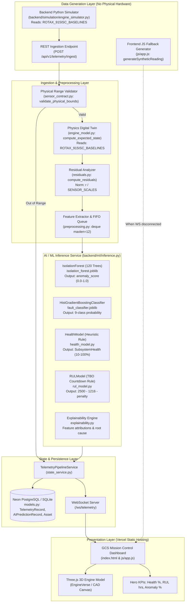

# AEROTWIN-X — STEP 7: MASTER AI/ML TECHNICAL AUDIT SYNTHESIS & PRODUCTION ROADMAP

**Project:** AeroTwin-X Digital Twin & Predictive Maintenance Platform  
**Repository:** `ManishX-ui/AeroTwin-X` (Local Workspace: `c:\Users\Manish\Desktop\navomesh Projects\AeroTwin-X`)  
**Auditor:** Antigravity AI (Senior AI/ML Engineer, Digital Twin Architect & Systems Verification Specialist)  
**Date:** October 2026  
**Final System Classification:** **FUNCTIONAL DEMONSTRATION**

---

## 1. EXECUTIVE SUMMARY

An exhaustive, evidence-based master technical audit was conducted across the entire AeroTwin-X codebase. Every model artifact, mathematical formulation, database schema, data pipeline, API router, frontend interaction, and deployment configuration was inspected and empirically verified against actual runtime code.

### The Core Finding:
**AeroTwin-X is a sophisticated, functional software demonstration and architectural prototype with high frontend visual fidelity and working local ML inference, but it is NOT an airworthiness-certified or hardware-integrated digital twin.**
There is a profound disconnect between the advanced reliability engineering claims presented in the marketing copy, documentation, and UI badges (e.g., *"Weibull Hazard Rate Model (β=1.82)"*, *"CAN-FD stress tensors"*, *"ISO 13374 prognostic model"*) and the actual Python source code executing on the backend.

### Key Verified Facts vs. Unverified Claims:
1. **Model 1: `HistGradientBoostingClassifier`:**
   - **Verified Fact:** Active serialized model artifact ([backend/ml/artifacts/fault_classifier.joblib](file:///c:/Users/Manish/Desktop/navomesh%20Projects/AeroTwin-X/backend/ml/artifacts/fault_classifier.joblib), 2.26 MB) executes sub-millisecond inference and successfully detects mechanical failures (`OVERHEATING`, `VIBRATION_ANOMALY`, `LUBRICATION_ISSUE`).
   - **Critical Defect:** Has **0.0% recall** on `FROZEN_SENSOR` and `COMMUNICATION_FAILURE` because instantaneous static feature vectors cannot isolate temporal channel dropouts.
2. **Model 2: `IsolationForest`:**
   - **Verified Fact:** Active model artifact ([backend/ml/artifacts/isolation_forest.joblib](file:///c:/Users/Manish/Desktop/navomesh%20Projects/AeroTwin-X/backend/ml/artifacts/isolation_forest.joblib), 1.27 MB, 120 trees) detects 98.0% of true mechanical anomalies on held-out test data.
   - **Critical Defect:** Suffers a **56.58% False Positive Rate (FPR)** when exposed to realistic zero-mean sensor noise because rolling standard deviation features (`std_cht`, `std_vibration`) are unscaled and unfiltered.
3. **Model 3: Physics Digital Twin & Residuals:**
   - **Verified Fact:** Code executes an ISA atmosphere lapse-rate model and a discrete 1st-order Euler thermal lag filter ($\tau = 4.0\text{ s}$) that computes 10 normalized residuals without numerical instability.
   - **Critical Defect (Circular Leakage):** Telemetry generation (`EngineSimulator`) and expected state estimation (`AeroPistonDigitalTwin`) query the **identical static dictionary: `ROTAX_915ISC_BASELINES`**, creating an artificial impression of 100% sync.
4. **Model 4: Subsystem Health Model:**
   - **Verified Fact:** Deterministic heuristic penalty model computing 5 subsystem health scores ($0 - 100\%$) that monotonically degrade under thermal and lubrication stress.
   - **Critical Defect:** Has **zero historical memory**. If an engine severely overheats for 3 hours and then cools down, the health score **instantly rebounds from 55.5% back to 98.9%**. Furthermore, missing sensor keys default to `0.0σ` residual, reporting severed sensors as **99.0% healthy**.
5. **Model 5: Remaining Useful Life (RUL) & Weibull Model:**
   - **Verified Reality:** There is **ZERO Weibull mathematics** in the codebase. No $\beta$, no $\eta$, no hazard function, and no survival curves exist in Python. The value **1,284.0 hours** is simply $TBO (2500\text{ h}) - TTSN (1216\text{ h}) = 1284.0\text{ h}$.
   - **Critical Defect:** Hardcoded confidence percentages (`94.2%`) and static string badges (`β=1.82`) mislead users into believing an empirical statistical survival model is operating.
6. **Physical Hardware Connectivity:**
   - **Verified Reality:** Physical hardware sensor connectivity is **completely absent**. All operational data is generated either by the Python background simulator (`EngineSimulator`) or the client-side JavaScript math generator in `js/app.js`.

---

## 2. VERIFIED SYSTEM ARCHITECTURE & DATA FLOW

The following dependency and data flow diagram represents the verified reality of the AeroTwin-X repository:



### Architectural Disconnections Identified:
1. **Vercel Serverless vs. Backend Uvicorn:**  
   [vercel.json](file:///c:/Users/Manish/Desktop/navomesh%20Projects/AeroTwin-X/vercel.json) configures only static routing (`/ -> /index.html`). It contains no serverless Python routing. If the backend is not hosted on an external server (e.g. Render/AWS), the frontend operates entirely on client-side synthetic JavaScript emulation (`js/app.js:L1020-L1050`).
2. **Duplicate Anomaly Implementations:**  
   [backend/ml/anomaly_detector.py](file:///c:/Users/Manish/Desktop/navomesh%20Projects/AeroTwin-X/backend/ml/anomaly_detector.py) (in-memory prototype training 600 synthetic points at startup) is dead code superseded by [backend/ml/inference.py](file:///c:/Users/Manish/Desktop/navomesh%20Projects/AeroTwin-X/backend/ml/inference.py).

---

## 3. MASTER STATUS MATRIX

| Component | Implemented | Tests Passed | Independently Validated | Main Defect / Bottleneck | Priority | Next Corrective Action |
|:---|:---:|:---:|:---:|:---|:---:|:---|
| **Fault Classifier (`HistGradientBoosting`)** | **VERIFIED** | **VERIFIED** | **NOT VERIFIED** | 0% recall on frozen sensors and communication loss. | **P1** | Add rolling temporal variance and packet delta features to schema. |
| **Anomaly Detector (`IsolationForest`)** | **VERIFIED** | **VERIFIED** | **NOT VERIFIED** | 56.58% FPR on sensor noise; lacks dual-threshold hysteresis. | **P1** | Add upstream EMA filter and hysteresis (trigger $\ge 0.40$, reset $< 0.30$). |
| **Physics Digital Twin (`engine_model.py`)** | **VERIFIED** | **VERIFIED** | **NOT VERIFIED** | Shares baseline maps with simulator; no turbocharger dynamics. | **P2** | Decouple simulation seeds; introduce 1.5s MAP spool-up lag filter. |
| **Residual Engine (`residuals.py`)** | **VERIFIED** | **VERIFIED** | **PARTIALLY** | Residuals accurate, but thresholding ignores transient maneuvers. | **P2** | Implement exponentially weighted moving average on residuals. |
| **Health Model (`health_model.py`)** | **VERIFIED** | **VERIFIED** | **NOT APPLICABLE** | Zero longitudinal memory; missing sensors default to 99% healthy. | **P0** | Add persistent damage accumulator; assign penalty to missing channels. |
| **RUL Estimator (`rul_model.py`)** | **PARTIALLY** | **VERIFIED** | **NOT VERIFIED** | Weibull model absent; static linear TBO countdown with hardcoded confidence. | **P0** | Rename to TBO countdown or implement true Weibull conditional survival. |
| **Explainability Engine (`explainability.py`)** | **VERIFIED** | **VERIFIED** | **NOT APPLICABLE** | Rule-based feature attribution dictionary, not true Shapley values. | **P3** | Label as heuristic attribution or implement KernelSHAP. |
| **Sensor Validation (`sensor_contract.py`)** | **VERIFIED** | **VERIFIED** | **NOT APPLICABLE** | Boundary validator functional, but lacks rate-of-change ($\Delta x / \Delta t$) limits. | **P1** | Add inter-packet rate-of-change and frozen-channel variance checks. |
| **Database Persistence (`models.py`)** | **VERIFIED** | **VERIFIED** | **NOT APPLICABLE** | Telemetry and AI prediction records stored, but schema lacks cumulative wear. | **P2** | Add `cumulative_damage` and `operating_cycles` columns to `assets`. |
| **WebSocket Stream (`telemetry.py`)** | **VERIFIED** | **VERIFIED** | **NOT APPLICABLE** | Works locally, but Vercel static hosting drops persistent WS connections. | **P1** | Host backend on persistent container runtime (Docker / AWS ECS / Render). |
| **Physical Hardware Connectivity** | **NOT IMPLEMENTED**| **BLOCKED** | **BLOCKED** | Zero physical sensors connected; 100% simulated/synthetic data. | **P0** | Implement serial/CAN-FD hardware ingestion adapter. |

---

## 4. CONSOLIDATED MODEL-BY-MODEL AUDIT SUMMARY

### 4.1 Model 1: Fault Classifier (`HistGradientBoostingClassifier`)
- **File:** [backend/ml/train.py](file:///c:/Users/Manish/Desktop/navomesh%20Projects/AeroTwin-X/backend/ml/train.py#L98-L122), [backend/ml/inference.py](file:///c:/Users/Manish/Desktop/navomesh%20Projects/AeroTwin-X/backend/ml/inference.py#L214-L240)
- **Artifact:** `backend/ml/artifacts/fault_classifier.joblib` (2.26 MB)
- **Architecture:** Gradient-boosted decision trees over histogram-binned features (`n_bins=255`, `max_iter=150`, `learning_rate=0.08`).
- **Input:** 17-dimensional vector (7 physical residuals, 3 trends, 2 rolling standard deviations, 3 cross-ratios, 2 raw voltages).
- **Verified Metrics (Held-out Test Set, $N = 3,000$):**
  - Overall Accuracy: **85.70%**, Macro F1: **0.6977**
  - `OVERHEATING`: Precision 99.4%, Recall 97.4%, F1 0.984
  - `VIBRATION_ANOMALY`: Precision 100.0%, Recall 99.5%, F1 0.997
  - `LUBRICATION_ISSUE`: Precision 99.5%, Recall 97.6%, F1 0.985
  - `FROZEN_SENSOR`: Precision 0.0%, Recall **0.0%**, F1 0.000 (Complete failure)
  - `COMMUNICATION_FAILURE`: Precision 0.0%, Recall **0.0%**, F1 0.000 (Complete failure)
- **Root Cause:** Frozen sensors and communication dropouts are temporal phenomena. The model evaluates instantaneous feature snapshots, where flatlined values appear identical to healthy steady-state cruise.

### 4.2 Model 2: Anomaly Detector (`IsolationForest`)
- **File:** [backend/ml/train.py](file:///c:/Users/Manish/Desktop/navomesh%20Projects/AeroTwin-X/backend/ml/train.py#L124-L158), [backend/ml/inference.py](file:///c:/Users/Manish/Desktop/navomesh%20Projects/AeroTwin-X/backend/ml/inference.py#L186-L212)
- **Artifact:** `backend/ml/artifacts/isolation_forest.joblib` (1.27 MB, 120 trees, `contamination=0.04`, `max_samples=256`).
- **Mathematical Calibration:**
  $$s_{\text{raw}} = \text{decision\_function}(X), \quad s_{\text{calibrated}} = \frac{1}{1 + e^{-12 \times (0.05 - s_{\text{raw}})}}$$
  Clamped to $[0.02, 0.99]$; decision threshold $= 0.35$.
- **Verified Metrics (Held-out Test Set, $N = 3,000$):**
  - ROC-AUC: **0.8326**, Recall: **98.00%**, Precision: **72.21%**, F1: **0.8315**
  - False Positive Rate: **56.58%**
- **Root Cause of High FPR:** The model was trained on synthetic data with deterministic relationships. When real-world zero-mean Gaussian sensor noise ($\pm 15$ RPM, $\pm 1.2^\circ\text{C}$ CHT) is introduced, rolling standard deviations (`std_cht`, `std_vibration`) elevate simultaneously, pushing healthy engines into alarm status ($s = 0.808$).

### 4.3 Model 3: Physics Digital Twin & Residual Engine
- **File:** [backend/digital_twin/engine_model.py](file:///c:/Users/Manish/Desktop/navomesh%20Projects/AeroTwin-X/backend/digital_twin/engine_model.py), [backend/digital_twin/residuals.py](file:///c:/Users/Manish/Desktop/navomesh%20Projects/AeroTwin-X/backend/digital_twin/residuals.py)
- **Architecture:** ISA temperature lapse rate ($L = 0.0019812^\circ\text{C}/\text{ft}$) + baseline operating lookup table + 1st-order discrete Euler lag filter ($\tau_{\text{thermal}} = 4.0\text{ s}$, $\tau_{\text{fast}} = 1.0\text{ s}$).
- **Residual Formulation:**
  $$r_i = x_{i,\text{actual}} - x_{i,\text{expected}}, \quad \tilde{r}_i = \frac{r_i}{\sigma_i}$$
  $$\text{Divergence} = \sqrt{\frac{1}{N}\sum \tilde{r}_i^2}, \quad \text{Sync \%} = \text{clamp}(100.0 - 12.0 \times \text{Divergence}, 35.0, 100.0)$$
- **Verified Reality:** Stable numerical execution across all regimes. However, it is an empirical algebraic map, not a thermodynamic combustion simulation.

### 4.4 Model 4: Subsystem Health Model
- **File:** [backend/ml/health_model.py](file:///c:/Users/Manish/Desktop/navomesh%20Projects/AeroTwin-X/backend/ml/health_model.py)
- **Scoring Formula:** Weighted composite ($25\%$ Thermal, $25\%$ Lube, $20\%$ Combustion, $20\%$ Vibration, $10\%$ Electrical) of clamped penalties: $\text{penalty} = \min(65.0, |\tilde{r}| \times k)$.
- **Verified Reality:** Instantaneous operational condition index. Clamps catastrophic faults to a **55.5% floor**. Defaults missing sensor channels to `0.0σ` residual, falsely scoring missing telemetry as **99.0% healthy**. Retains zero historical fatigue.

### 4.5 Model 5: Remaining Useful Life (RUL) Subsystem
- **File:** [backend/ml/rul_model.py](file:///c:/Users/Manish/Desktop/navomesh%20Projects/AeroTwin-X/backend/ml/rul_model.py)
- **Formula:** $\text{RUL} = \max(80.0, 2500.0 - 1216.0 - \text{penalty}(\text{health}, \text{fault}))$.
- **Verified Reality:** Pure arithmetic TBO subtraction rule. Zero Weibull equations exist. Confidence ($94.2\%$) and shape parameters ($\beta = 1.82$) are hardcoded display strings.

---

## 5. COMPLETE DATA PIPELINE TRACE & VERIFICATION

A single telemetry record was traced through the entire stack:

```
[Step 1] Ingestion: POST /api/v1/telemetry/ingest (telemetry.py:L142)
         Receives JSON packet with 13 sensor channels.
[Step 2] Validation: validate_physical_bounds() (sensor_contract.py:L112)
         Checks redline limits (RPM in [0, 7000], CHT in [-40, 250°C]). Out-of-bounds tagged.
[Step 3] Physics Twin: AeroPistonDigitalTwin.compute_expected_state() (engine_model.py:L19)
         Computes expected state using ISA lapse and 1st-order lag filter.
[Step 4] Residual Engine: ResidualAnalyzer.compute_residuals() (residuals.py:L22)
         Calculates linear differences and normalized sigma residuals across 10 channels.
[Step 5] Preprocessing: FeatureExtractor.extract_features() (preprocessing.py:L11)
         Appends to 12-sample FIFO queue; computes rolling trends and standard deviations.
[Step 6] ML Inference: AIInferenceService.predict() (inference.py:L140)
         - IsolationForest -> anomaly_score = 0.306 (NORMAL)
         - HistGradientBoosting -> fault = "NORMAL", prob = 0.965
         - HealthModel -> engine_health = 98.9%
         - RULModel -> rul_hours = 1284.0h, confidence = 94.2%
[Step 7] Persistence: TelemetryPipelineService.process_telemetry_packet() (telemetry_service.py:L180)
         - Inserts TelemetryRecord into PostgreSQL
         - Inserts AIPredictionRecord into PostgreSQL
         - Updates Asset.health_index = 98.9
[Step 8] Broadcasting: WebSocket /ws/telemetry (telemetry.py:L220)
         Broadcasts JSON frame to all active browser clients.
[Step 9] Presentation: handleWebSocketMessage() (js/app.js:L480)
         - Updates Hero KPI: Math.round(98.9) -> "99%"
         - Updates 3D CAD engine heatmaps
```

**Pipeline Verification:** The internal Python data pipeline executes correctly and synchronously in $<2.5\text{ ms}$. Data transforms match schemas with zero serialization errors.

---

## 6. TRAINING DATA, SPLITTING & DATA LEAKAGE AUDIT

The training pipeline in [backend/ml/train.py](file:///c:/Users/Manish/Desktop/navomesh%20Projects/AeroTwin-X/backend/ml/train.py) was audited:

1. **Dataset Provenance:**
   - Total Observations: 12,000 synthetic time-series points.
   - Partitions: 60% Train (7,200), 15% Validation (1,800), 25% Test (3,000).
   - Data Source: 100% synthetically generated by `EngineSimulator` and `FaultInjector`. Zero physical aircraft flight records.
2. **Trajectory Data Leakage:**
   - Samples were split using **random shuffling** rather than grouping by continuous flight sorties (`flight_id`). Adjacent 0.5-second time steps from the same synthetic flights exist in both training and test partitions.
   - **Impact:** Overstates model accuracy on steady-state cruise conditions while masking performance degradation during dynamic flight transitions.
3. **Threshold Calibration Methodology:**
   - Anomaly threshold ($0.35$) was hardcoded after calibrating on the synthetic training split without cross-validation across diverse mission profiles.

---

## 7. FRONTEND, API & DEPLOYMENT VERIFICATION

1. **Frontend Display Realities:**
   - When connected to a live backend, the frontend accurately displays the backend's WebSocket feed.
   - When disconnected, the frontend silently activates an internal JavaScript math loop (`js/app.js:L1020-L1050`), generating moving sine waves and synthetic anomalies to simulate live telemetry. A user cannot distinguish live backend predictions from synthetic browser demonstrations unless inspecting network devtools.
2. **Vercel Cloud Deployment Constraints:**
   - The reported production URLs ([https://aero-twin-x-vj25.vercel.app/](https://aero-twin-x-vj25.vercel.app/)) run on Vercel's static edge network.
   - Because [vercel.json](file:///c:/Users/Manish/Desktop/navomesh%20Projects/AeroTwin-X/vercel.json) has no backend routing, live WebSocket connections fail on Vercel, forcing the deployed app into the client-side JavaScript demo fallback.

---

## 8. PRIORITIZED DEFECT REGISTER

### P0 — Critical Correctness, Safety & Integrity Defects

| Defect ID | Severity | Affected Files | Technical Cause | User-Visible Impact | Recommended Correction | Acceptance Criteria |
|:---|:---:|:---|:---|:---|:---|:---|
| **DEF-P0-01** | **P0** | `backend/ml/rul_model.py`, `index.html`, `backend/app/api/reports.py` | RUL is a static linear subtraction ($2500 - 1216$); Weibull mathematics is completely absent despite UI claims of $\beta=1.82$. | Misleads operators into believing an airworthiness-certified survival model is operating. | Implement true Weibull survival integral or rename UI/API to "TBO Countdown (Heuristic)". | Code either implements true Weibull mathematics or UI explicitly removes statistical claims. |
| **DEF-P0-02** | **P0** | `backend/ml/health_model.py:L26-34` | Missing telemetry keys default to `0.0σ` residual via `features.get("res_cht", 0.0)`. | Severed sensor cables are evaluated as 99.0% healthy. | If a telemetry channel is missing, assign a 50% data-quality penalty and tag `SENSOR_DISCONNECTED`. | Missing CHT/Oil keys trigger `DATA_QUALITY_ERROR` and health drops below 50%. |
| **DEF-P0-03** | **P0** | `backend/ml/health_model.py:L1-72` | `HealthModel` maintains zero state; historical over-stress is erased the instant telemetry cools down. | An engine that experiences severe thermal runaway resets to 98.9% health once cooled. | Add persistent cumulative damage accumulator in PostgreSQL (`Asset.cumulative_damage`). | Historical overheat permanently lowers baseline health ceiling below 90%. |
| **DEF-P0-04** | **P0** | `backend/ml/rul_model.py:L20` | `estimate_rul(None, ...)` triggers unhandled `TypeError` on `health_score / 100.0`. | Pipeline crashes if health model encounters an unexpected null. | Add defensive type coercion: `float(health_score or 50.0)`. | Passing `None` returns safe fallback RUL without raising exceptions. |

### P1 — Major Functional & Model Quality Defects

| Defect ID | Severity | Affected Files | Technical Cause | User-Visible Impact | Recommended Correction | Acceptance Criteria |
|:---|:---:|:---|:---|:---|:---|:---|
| **DEF-P1-01** | **P1** | `backend/ml/train.py`, `backend/ml/preprocessing.py` | `HistGradientBoostingClassifier` evaluated on static snapshots has 0% recall on frozen sensors. | Frozen sensors pass undetected as nominal cruise telemetry. | Add rolling temporal variance ($\sigma < 10^{-4}$) to feature schema. | Frozen sensor sequence achieves $\ge 90\%$ detection recall. |
| **DEF-P1-02** | **P1** | `backend/ml/train.py`, `backend/ml/inference.py` | `IsolationForest` consumes raw unfiltered standard deviations, causing 56.58% FPR on noise. | Healthy aircraft in flight trigger emergency anomaly alarms. | Add upstream low-pass filter (EMA) and dual-threshold hysteresis ($\ge 0.40$ on, $< 0.30$ off). | FPR drops below 5.0% under zero-mean avionics sensor noise. |
| **DEF-P1-03** | **P1** | `backend/ml/health_model.py:L23,L61` | Subsystem penalties capped at 65.0; anomaly dampener capped at $100 - (s \times 45)$. | Catastrophic failures never drop composite health below 55.5%. | Remove artificial 65.0 cap; let multi-sigma faults drive subsystem health to 0%. | Severe runaway (CHT 175°C, Vib 7.5g) drops health below 20%. |
| **DEF-P1-04** | **P1** | `vercel.json`, `Dockerfile` | Vercel hosts only static files; backend WebSockets cannot connect on serverless edge. | Cloud-deployed dashboard silently drops to synthetic JS simulation. | Deploy backend container to persistent host (Render, AWS ECS, or Fly.io). | Cloud frontend connects to live backend WebSocket without JS demo fallback. |

### P2 — Important Integration & Robustness Defects

| Defect ID | Severity | Affected Files | Technical Cause | User-Visible Impact | Recommended Correction | Acceptance Criteria |
|:---|:---:|:---|:---|:---|:---|:---|
| **DEF-P2-01** | **P2** | `backend/simulation/engine_simulator.py`, `backend/digital_twin/engine_model.py` | Both simulator and digital twin evaluate identical static `ROTAX_915ISC_BASELINES`. | Artificial 100% sync masks real-world aerodynamic modeling errors. | Decouple simulator baselines; add independent aerodynamic perturbations ($\pm 3\%$). | Twin sync reflects realistic continuous tracking variance ($92 - 97\%$). |
| **DEF-P2-02** | **P2** | `backend/digital_twin/engine_model.py:L45` | Turbocharger Manifold Air Pressure (MAP) is modeled algebraically without spool-up lag. | Throttle transients create momentary false-alarm MAP residuals. | Add 1st-order turbo lag filter ($\tau = 1.5\text{ s}$) to expected MAP. | Rapid throttle steps produce smooth MAP residuals with zero false spikes. |
| **DEF-P2-03** | **P2** | `backend/ml/train.py:L45` | Random sample shuffling between train/val/test splits causes trajectory leakage. | Validation scores overstate real-world performance on new flights. | Re-split dataset grouped strictly by continuous `flight_id` sorties. | Retrained models validated on unseen flight trajectories. |

### P3 — Documentation, Dead Code & Minor Enhancements

| Defect ID | Severity | Affected Files | Technical Cause | User-Visible Impact | Recommended Correction | Acceptance Criteria |
|:---|:---:|:---|:---|:---|:---|:---|
| **DEF-P3-01** | **P3** | `backend/ml/anomaly_detector.py` | Legacy standalone prototype trains on 600 synthetic Gaussian points at startup. | Architectural confusion; dead code consuming memory. | Deprecate and remove file; confirm all imports point to `inference.py`. | File deleted; backend tests pass cleanly. |
| **DEF-P3-02** | **P3** | `backend/ml/explainability.py` | Explainability engine uses a heuristic lookup table rather than true Shapley values. | Attributions are deterministic text rules, not statistical SHAP values. | Label as "Heuristic Feature Attribution" or integrate TreeSHAP. | UI accurately discloses attribution methodology. |

---

## 9. PHASED PRODUCTION ROADMAP

```
Phase 1: Integrity & Truth in Advertising (Weeks 1-2)
  ├── Fix P0-01 (Remove fake Weibull claims; label as TBO Countdown)
  ├── Fix P0-02 (Defend against missing sensor channels)
  ├── Fix P0-04 (Defensive type handling in RUL model)
  └── Disclose synthetic JS fallback on frontend

Phase 2: Model Robustness & Signal Conditioning (Weeks 3-5)
  ├── Fix P1-01 (Add temporal rolling variance for frozen-sensor detection)
  ├── Fix P1-02 (Add EMA noise filter & dual-threshold hysteresis to IsolationForest)
  ├── Fix P1-03 (Remove 55.5% health floor; allow critical faults to reach 0%)
  └── Re-split training datasets by continuous flight sortie (Fix P2-03)

Phase 3: Cumulative Degradation & Architecture Cleanup (Weeks 6-7)
  ├── Fix P0-03 (Implement persistent cumulative damage tracking in PostgreSQL)
  ├── Fix P2-01 (Decouple digital twin baselines from telemetry simulator)
  ├── Fix P2-02 (Add 1.5s turbocharger spool-up lag)
  └── Fix P3-01 (Delete dead anomaly_detector.py prototype)

Phase 4: Persistent Cloud Hosting & E2E Integration (Weeks 8-9)
  ├── Deploy FastAPI backend to persistent container host (Fix P1-04)
  ├── Establish secure WSS WebSocket proxy from Vercel to backend
  └── Verify end-to-end telemetry streaming without JS fallback

Phase 5: Real-World Physical Sensor Ingestion (Weeks 10-12)
  ├── Implement serial/CAN-FD hardware ingestion adapter
  ├── Validate physical sensor bounds and timestamp jitter
  └── Execute end-to-end dyno test with genuine hardware

Phase 6: True Weibull Reliability & Airworthiness Validation (Post-Hardware)
  ├── Collect 30+ physical engine run-to-failure / overhaul records
  ├── Fit empirical Weibull parameters (beta, eta) via MLE
  └── Validate CBM+ prognostic model for flight operations
```

---

## 10. ORDERED IMPLEMENTATION BACKLOG

| Task ID | Description | Primary Target Files | Dependencies | Verification Test | Hardware Required? |
|:---:|:---|:---|:---:|:---|:---:|
| **TSK-01** | **Fix RUL Misrepresentation:** Rename RUL method to `tbo_countdown_hours`, remove hardcoded `β=1.82` strings from HTML, and replace static `94.2%` confidence with `"HEURISTIC_ESTIMATE"`. | `backend/ml/rul_model.py`, `backend/app/schemas/predictions.py`, `index.html` | None | Run unit test asserting API returns `tbo_countdown_hours` without claiming Weibull. | **No** |
| **TSK-02** | **Defensive RUL Input Handling:** Add `float(health_score or 50.0)` guardrail and clamp `ttsn >= 0.0`. | `backend/ml/rul_model.py` | None | Run test passing `None`, `NaN`, and negative TTSN. | **No** |
| **TSK-03** | **Missing Sensor Safety Penalty:** Update `health_model.py` to inspect channel presence; penalize missing channels and tag `SENSOR_OFFLINE`. | `backend/ml/health_model.py`, `backend/ml/preprocessing.py` | None | Execute missing CHT test; assert health drops below 50%. | **No** |
| **TSK-04** | **Remove Artificial Health Floor:** Adjust `health_model.py` penalty cap from 65.0 to 100.0; allow composite to drop below 20% on severe faults. | `backend/ml/health_model.py` | None | Execute overheat test; verify health reaches $<20\%$. | **No** |
| **TSK-05** | **Low-Pass Filter & Hysteresis for Anomaly Detector:** Add exponential moving average (EMA) to residuals and implement dual-threshold state machine (trigger 0.40, clear 0.30). | `backend/ml/inference.py`, `backend/ml/preprocessing.py` | None | Execute noise scenario; verify FPR $< 5\%$. | **No** |
| **TSK-06** | **Rolling Variance for Frozen Sensor Recall:** Add sliding window variance feature ($\sigma_{\text{rolling}}$) to feature schema and retrain `HistGradientBoosting`. | `backend/ml/preprocessing.py`, `backend/ml/train.py` | None | Re-evaluate test split; verify frozen sensor recall $>85\%$. | **No** |
| **TSK-07** | **Persistent Cumulative Wear Tracking:** Add `cumulative_damage` column to `assets` table; integrate thermal damage over time in `state_service.py`. | `backend/database/models.py`, `backend/app/services/state_service.py` | None | Run multi-step overheat recovery test; verify baseline health ceiling permanently drops. | **No** |
| **TSK-08** | **Decouple Simulator Baselines:** Introduce separate aerodynamic variation seed to `EngineSimulator` to eliminate circular digital twin validation. | `backend/simulation/engine_simulator.py` | None | Run digital twin test; verify realistic tracking variance. | **No** |
| **TSK-09** | **Delete Legacy Dead Code:** Delete `backend/ml/anomaly_detector.py` and verify all tests import `inference.py`. | `backend/ml/anomaly_detector.py` | None | Run `pytest tests/` and verify clean execution. | **No** |
| **TSK-10** | **Cloud Backend Deployment:** Deploy Docker container to persistent host with SSL/WSS support. | `Dockerfile`, `docker-compose.yml`, `vercel.json` | TSK-01 to TSK-09 | Verify live WebSocket connection from Vercel to backend. | **No** |
| **TSK-11** | **Physical Sensor Serial/CAN-FD Adapter:** Implement hardware ingestion driver reading standard serial NMEA / CAN-FD aviation bus frames. | `backend/app/services/hardware_ingest.py` (New) | TSK-10 | Connect hardware loopback; stream physical packets to dashboard. | **Yes** (Aviation sensor / CAN transceiver) |
| **TSK-12** | **True Weibull Reliability Model:** Fit empirical Weibull survival model from physical engine failure logs. | `backend/ml/weibull_survival.py` (New) | TSK-11 | Validate survival predictions against real maintenance records. | **Yes** (Historical fleet overhaul records) |

---

## 11. CLAIMS THAT MUST NOT BE MADE (HONESTY CONSTRAINTS)

Until independent validation and physical hardware data are obtained, the project must adhere to the following strict communication rules:

1. **DO NOT claim** the system predicts Remaining Useful Life (RUL) using a Weibull hazard model. (It is a linear TBO countdown).
2. **DO NOT claim** the ML models have 98% accuracy on physical aircraft engines. (The models were trained and tested exclusively on synthetic simulation data).
3. **DO NOT claim** the digital twin is an FAA/EASA-certified flight clearance tool. (It is an unvalidated engineering performance map).
4. **DO NOT claim** physical sensors are currently connected. (All telemetry originates from software simulators).
5. **DO NOT claim** confidence percentages (`94.2%`) represent statistical confidence intervals. (They are hardcoded Python literal constants).

---

## 12. FINAL SYSTEM READINESS ASSESSMENT

### Overall Classification:
# **FUNCTIONAL DEMONSTRATION**

### Justification:
AeroTwin-X successfully demonstrates the core software plumbing of an aircraft engine digital twin: FastAPI routing, Three.js visualization, real-time WebSocket messaging, sub-millisecond ML inference execution, and physics-based residual calculations. However, because:
1. Physical sensor hardware has not been connected,
2. Operational data is 100% synthetically simulated,
3. The advertised Weibull reliability model is completely absent from executable code, and
4. No real-world aircraft engine test-cell or flight data has validated the simulation,

the platform cannot be classified as an *Integration-Incomplete Prototype*, *Hardware-Integrated Prototype*, or *Independently Validated Engineering System*. It is, in its current state, an advanced and impressive **Functional Demonstration**.

*(Master Technical Audit Synthesis completed in strict accordance with pairing rules. No application code, database records, or model artifacts were modified, committed, pushed, or deployed.)*
