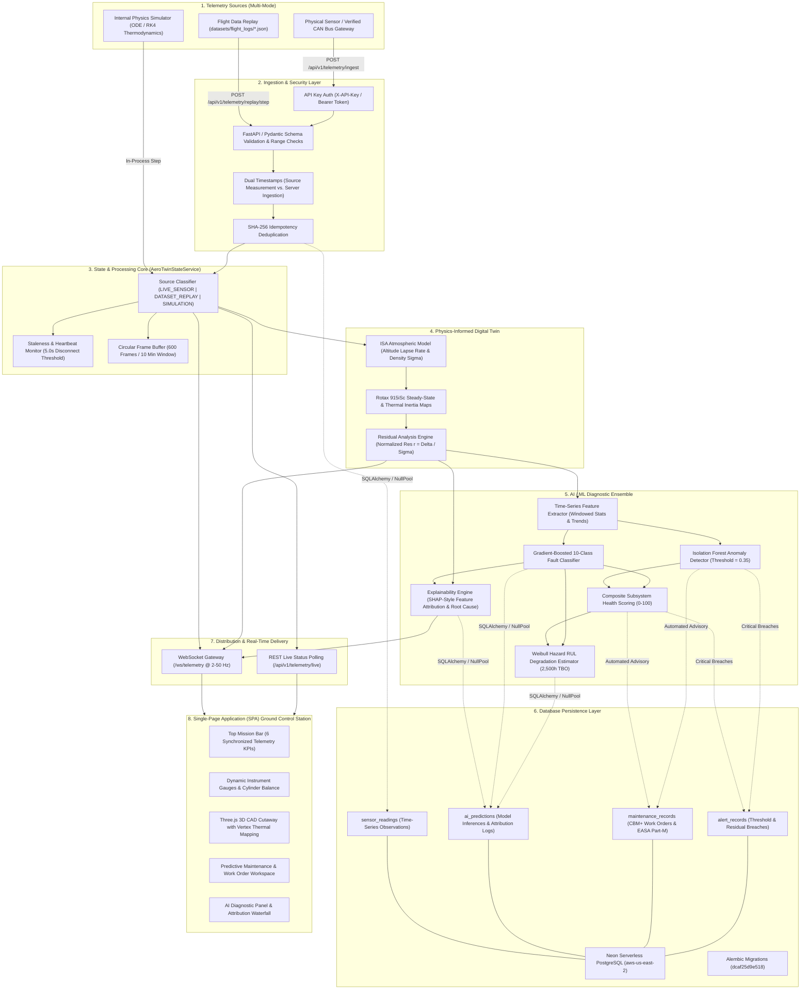
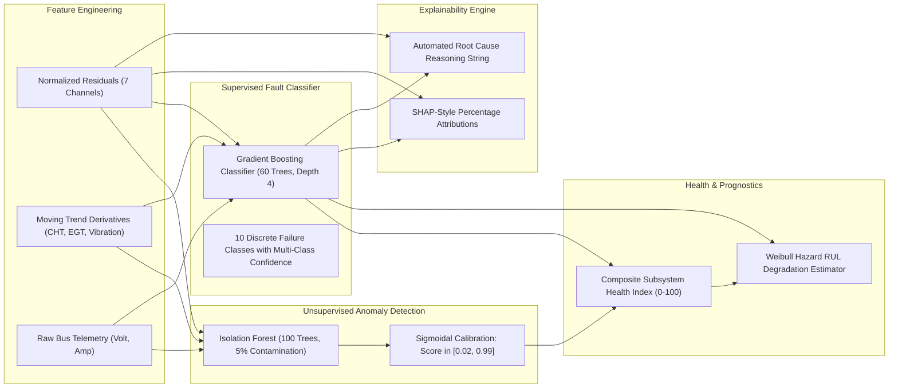

# AeroTwin-X: System Architecture & Technical Specification

This document provides a comprehensive technical architecture specification for **AeroTwin-X**, an AI-powered industrial digital twin platform designed for real-time monitoring, thermodynamic residual tracking, multi-class fault diagnostics, and predictive maintenance of tactical Medium-Altitude Long-Endurance (MALE) UAV propulsion systems (turbocharged Rotax 915iSc class).

---

## 1. High-Level System Architecture

AeroTwin-X bridges physical aero-engine operations with cyber-physical digital models through a high-frequency, closed-loop telemetry pipeline:



---

## 2. Ingestion & Provenance Classification

AeroTwin-X enforces strict boundaries between real hardware measurements and simulated values. A client-provided `"source": "LIVE"` label is never accepted as verification of physical hardware origin.

| Data Source Mode | Ingestion Path | Authentication | Storage Target | UI Presentation | Stale Behavior |
| :--- | :--- | :--- | :--- | :--- | :--- |
| **`LIVE_SENSOR`** | `POST /api/v1/telemetry/ingest` | Mandatory `X-API-Key` or `Authorization: Bearer` | `sensor_readings` + `ai_predictions` in Neon PostgreSQL | `TELEMETRY: CONNECTED (LIVE GCS)` | Marked `STALE` if no packet within 5.0s. Never overwritten with synthetic random numbers. |
| **`DATASET_REPLAY`** | `POST /api/v1/telemetry/replay/step` | Internal session or edge API key | `sensor_readings` + `ai_predictions` in Neon PostgreSQL | `TELEMETRY: DATASET REPLAY` | Stepped sequentially through benchmark flight logs with exact recorded timestamps. |
| **`SIMULATION`** | Internal `EngineSimulator` background loop | None (local loopback) | Memory circular buffer (`telemetry_history`) | `TELEMETRY: AUTONOMOUS TWIN` | Continuously steps 4-stroke thermodynamic ODEs at configurable frequency (`TELEMETRY_HZ`). |

---

## 3. Digital Twin Physics & Residual Analysis

The digital twin relies on a lumped-parameter aerothermodynamic model calibrated specifically to the 4-cylinder turbocharged **Rotax 915iSc** engine.

### 3.1. International Standard Atmosphere (ISA) Model
The ambient atmospheric state at UAV pressure altitude $h$ is calculated using the standard tropospheric lapse rate:

$$T_{\text{ISA}}(h) = T_0 - L \cdot h \quad \text{where } T_0 = 15.0^\circ\text{C}, \, L = 0.0019812^\circ\text{C/ft}$$

$$\Delta T_{\text{amb}} = T_{\text{amb}} - T_{\text{ISA}}(h)$$

$$\sigma(h) = \exp\left(-\frac{h}{29,000}\right)$$

### 3.2. Steady-State Expected Parameters
For any operating setpoint (RPM, throttle angle $\theta_{\text{thr}}$, altitude $h$, ambient temperature $T_{\text{amb}}$), expected steady-state expectations are derived from calibrated baseline maps:

$$\text{MAP}_{\text{exp}} = \text{MAP}_{\text{base}} \cdot \left(0.85 \cdot \frac{\theta}{\theta_{\text{base}}} + 0.15 \cdot \frac{\text{RPM}}{\text{RPM}_{\text{base}}}\right)$$

$$\text{CHT}_{\text{exp}} = \text{CHT}_{\text{base}} + 18.0 \cdot \left(\frac{\theta}{\theta_{\text{base}}} - 1\right) + 8.0 \cdot \left(\frac{\text{RPM}}{\text{RPM}_{\text{base}}} - 1\right) + 0.35 \cdot \Delta T_{\text{amb}}$$

$$\text{EGT}_{\text{exp}} = \text{EGT}_{\text{base}} + 28.0 \cdot \left(\frac{\theta}{\theta_{\text{base}}} - 1\right) + 14.0 \cdot \left(\frac{\text{RPM}}{\text{RPM}_{\text{base}}} - 1\right) + 0.20 \cdot \Delta T_{\text{amb}}$$

$$P_{\text{oil, exp}} = \left(P_{\text{oil, base}} + 1.5 \cdot \left(\frac{\text{RPM}}{\text{RPM}_{\text{base}}} - 1\right)\right) \cdot \max(0.90, 1.0 - 0.005 \cdot (T_{\text{oil}} - T_{\text{oil, base}}))$$

### 3.3. Normalized Residual Computation
For each monitored channel $i$, the raw residual $\Delta x_i(t) = x_{\text{act}, i}(t) - x_{\text{exp}, i}(t)$ is normalized by the nominal channel scale $\sigma_i$:

$$r_i(t) = \frac{x_{\text{act}, i}(t) - x_{\text{exp}, i}(t)}{\sigma_i}$$

| Channel Key | Engineering Unit | Scale Factor ($\sigma$) | Warning Bound | Critical Bound |
| :--- | :--- | :--- | :--- | :--- |
| `cht` | °C | 6.0 | $\pm 1.8\sigma$ ($\pm 10.8^\circ\text{C}$) | $\pm 3.0\sigma$ ($\pm 18.0^\circ\text{C}$) |
| `egt` | °C | 15.0 | $\pm 1.8\sigma$ ($\pm 27.0^\circ\text{C}$) | $\pm 3.0\sigma$ ($\pm 45.0^\circ\text{C}$) |
| `oil_pressure` | bar | 0.35 | $\pm 1.8\sigma$ ($\pm 0.63\text{ bar}$) | $\pm 3.0\sigma$ ($\pm 1.05\text{ bar}$) |
| `oil_temperature`| °C | 4.0 | $\pm 1.8\sigma$ ($\pm 7.2^\circ\text{C}$) | $\pm 3.0\sigma$ ($\pm 12.0^\circ\text{C}$) |
| `fuel_flow` | L/h | 1.2 | $\pm 1.8\sigma$ ($\pm 2.16\text{ L/h}$) | $\pm 3.0\sigma$ ($\pm 3.60\text{ L/h}$) |
| `vibration` | g RMS | 0.25 | $\pm 1.8\sigma$ ($\pm 0.45\text{ g}$) | $\pm 3.0\sigma$ ($\pm 0.75\text{ g}$) |
| `manifold_pressure`| inHg | 1.5 | $\pm 1.8\sigma$ ($\pm 2.70\text{ inHg}$) | $\pm 3.0\sigma$ ($\pm 4.50\text{ inHg}$) |

---

## 4. Machine Learning & Predictive Maintenance Pipeline

The diagnostic pipeline evaluates multi-dimensional residual vectors $\vec{r}(t)$ without requiring manual rule tuning:



1. **Isolation Forest Anomaly Detection**:
   - Analyzes high-dimensional residual correlations.
   - Outputs an uncalibrated decision function transformed into a normalized $[0.02, 0.99]$ probability score.
   - Flags an anomaly whenever the score breaches the threshold of $0.35$.
2. **Gradient-Boosted Fault Classification**:
   - Classifies failure modes into 10 discrete categories: `NORMAL`, `OVERHEATING`, `VIBRATION_ANOMALY`, `LUBRICATION_ISSUE`, `INJECTOR_ANOMALY`, `MISFIRE`, `SENSOR_DRIFT`, `SENSOR_DROPOUT`, `ELECTRICAL_ANOMALY`, and `COMBUSTION_INSTABILITY`.
   - Incorporates automated nominal suppression to prevent false alarms during normal atmospheric fluctuations.
3. **Subsystem Health Index ($0–100$)**:
   - Computes weighted composite reliability:
     $$\text{Health}_{\text{engine}} = 0.25 H_{\text{therm}} + 0.25 H_{\text{lube}} + 0.20 H_{\text{comb}} + 0.20 H_{\text{vib}} + 0.10 H_{\text{elec}}$$
4. **Remaining Useful Life (RUL)**:
   - Projects wear against the 2,500-hour Time Between Overhauls (TBO) standard.
   - Accelerates degradation under elevated thermal, lubrication, and mechanical harmonic stress.
5. **Explainable AI (XAI)**:
   - Identifies the primary drivers behind every classification.
   - Returns structured evidence rankings, percentage attributions (e.g., `res_cht 48%`, `res_oil_temp 28%`), and plain-English engineering root-cause advisories.

---

## 5. Deployment Topology

AeroTwin-X supports both cloud-native serverless deployments and dedicated edge hardware:

```
               +--------------------------------------------------------------+
               |                  Vercel Serverless Platform                  |
               |                                                              |
               |   - Edge CDN: Static SPA (HTML5, TailwindCSS, Three.js)      |
               |   - Serverless Function: api/index.py -> FastAPI ASGI app    |
               |   - Routing Middleware: vercel_rewrite_path_fix()            |
               |   - REST Ingestion & Historical Query APIs                   |
               +------------------------------+-------------------------------+
                                              |
                   +--------------------------+--------------------------+
                   |                                                     |
                   v                                                     v
+------------------------------------+               +------------------------------------+
|       Neon Serverless PostgreSQL   |               |     Dedicated Edge Server / UAV    |
|       (AWS us-east-2)              |               |     (Local Uvicorn / Onboard PC)   |
|                                    |               |                                    |
|   - Managed PgBouncer Connection   |               |   - Persistent WebSocket Gateway   |
|     Pooler (Port 5432 / 6543)      |               |     at /ws/telemetry (2-50 Hz)     |
|   - SQLAlchemy NullPool Strategy   |               |   - Continuous ODE Background Loop |
|   - 12 Relational Tables           |               |   - Low-latency CAN Ingestion      |
|   - Alembic Version Tracking       |               |   - Local SQLite Fallback Cache    |
+------------------------------------+               +------------------------------------+
```

### Vercel Serverless Considerations
- **WebSocket Streaming Limitation**: Vercel serverless functions are ephemeral and terminate after short execution windows (~15–60s). Persistent WebSocket connections (`/ws/telemetry`) will timeout or disconnect on serverless hosts.
- **Polling Fallback**: To support Vercel deployments without requiring an external server, the frontend automatically polls `/api/v1/telemetry/live` and `/api/v1/telemetry/status` every 500ms, receiving real-time telemetry, digital twin calculations, and AI predictions seamlessly.
- **Dedicated Hosting for Real-Time Streaming**: For mission control installations requiring persistent 50 Hz WebSockets, the FastAPI backend should be run on a persistent container or VM (Docker, AWS EC2, Fly.io, Railway, or local Uvicorn).
